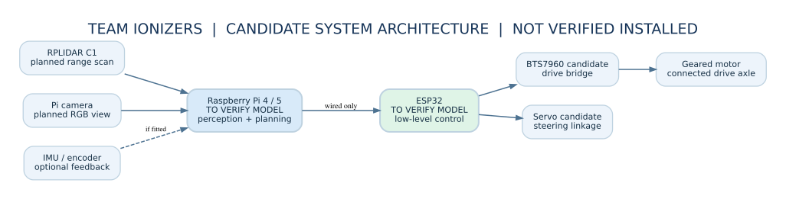
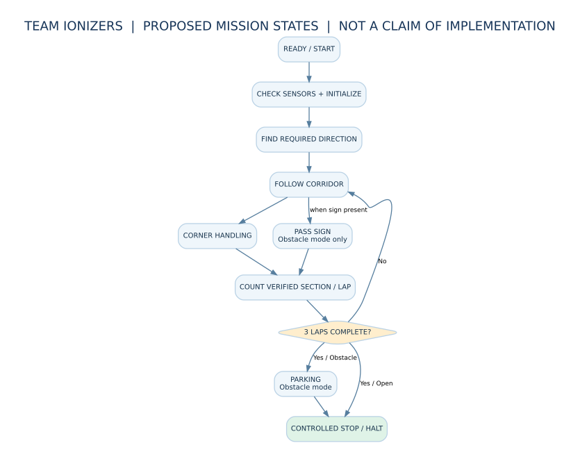

# TEAM IONIZERS
### WRO 2026 | Future Engineers | Bangladesh | International Final — Puerto Rico

> **Engineering documentation draft — 14 November 2026.** This repository is designed to record **our own** autonomous-vehicle engineering for the WRO 2026 Future Engineers competition. The team name and international selection are confirmed. Many technical details below are **reported development plans, estimates, or proposed architectural choices**, not independently verified facts about the competition-ready robot. No unprovided competition control program, test run, photo, CAD file, or historical commit has been fabricated. Before official submission, members should replace all `TO VERIFY` entries with records from the physical robot and insert their original code and evidence.

**Team:** Team Ionizers  
**Country:** Bangladesh 🇧🇩  
**Category:** WRO Future Engineers — Self-Driving Cars  
**Event:** WRO International Final 2026, Puerto Rico  
**Team lead:** Al Amin Sani  
**Robot revision:** V2 **under verification**  
**Engineering journal:** [Read the journal](docs/Engineering_Journal.md) · [Printable PDF](docs/Engineering_Journal.pdf)  
**Current submission readiness:** [STATUS.md](STATUS.md) · [Important actions](START_HERE.md)

---

## Contents
1. [Project and competition goals](#1-project-and-competition-goals)
2. [Robot overview and evidence status](#2-robot-overview-and-evidence-status)
3. [Mobility and drivetrain](#3-mobility-and-drivetrain)
4. [Power distribution and sensors](#4-power-distribution-and-sensors)
5. [Software architecture](#5-software-architecture)
6. [Open Challenge approach](#6-open-challenge-approach)
7. [Obstacle Challenge approach](#7-obstacle-challenge-approach)
8. [2026 Surprise Rule](#8-2026-surprise-rule)
9. [Testing and improvement](#9-testing-and-improvement)
10. [Building, installing, and reproducing](#10-building-installing-and-reproducing)
11. [Repository organization](#11-repository-organization)
12. [Videos, photos and CAD](#12-videos-photos-and-cad)
13. [Rules and deadlines](#13-rules-and-deadlines)
14. [Engineering integrity and references](#14-engineering-integrity-and-references)

## 1. Project and competition goals
Team Ionizers is a student robotics team selected to represent Bangladesh in the WRO 2026 Future Engineers International Final. The challenge is to create an **autonomous, four-wheeled, steerable** vehicle that navigates a changing track, determines its direction of travel from the allowed start situation, passes colored traffic signs correctly, and comes to a complete stop at the end of three laps. The Obstacle Challenge additionally includes parallel parking; the International Final has a separately announced optional modified-sign Surprise Rule.

Our design discussions have prioritized reliable three-lap completion and low lap time. **Development targets, not achieved test results:** approximately **18–20 seconds** for the Open Challenge and **under 30 seconds** for the Obstacle Challenge. We have discussed a three-profile tuning philosophy (**Safe / Medium / Max**) for managing speed versus risk; these are proposed parameter profiles and must not be presented as three proven programs without corresponding files and logs.

The course and starting zone can vary. A fast straight-line vehicle alone is not sufficient: all sensing, turning, steering precision, stopping, sign interpretation, and safety margins matter. A complete result must therefore be measured across randomized track layouts, different lighting conditions, different battery voltages, and different pillar positions. See [testing methods](docs/04_testing_and_data.md).

## 2. Robot overview and evidence status
The team has discussed a hybrid sensing/control architecture: a Raspberry Pi single-board computer for higher-level perception and planning, an ESP32 microcontroller for time-sensitive motor/servo functions, an RPLIDAR C1 for range sensing, a Pi camera for color perception, and potentially an IMU and encoders for motion estimation. **This is the V2 architecture under consideration** rather than a statement that every item is installed in the final vehicle.

| Subsystem | Discussed design | Current record status |
|---|---|---|
| Main processing | Raspberry Pi 4 (8 GB discussed); Pi 5 (8 GB considered as upgrade) | **TO VERIFY installed model** |
| Real-time controller | ESP32 | **TO VERIFY installed model / pinout** |
| Range sensor | RPLIDAR C1 | **TO VERIFY installation and scan plane** |
| Color/vision | Raspberry Pi camera | **TO VERIFY exact module, orientation and software** |
| Motion feedback | Wheel encoder and optional IMU | **TO VERIFY actual installed sensors** |
| Drive | 25GA370-class geared DC motor, approximately 1300–1360 RPM discussed | **TO VERIFY motor part, loaded RPM, gear train** |
| Motor driver | BTS7960 candidate | **TO VERIFY exact module and wiring** |
| Steering | MG90S servo candidate | **TO VERIFY actual servo and linkage** |
| Wheels | 54 mm diameter discussed | **TO VERIFY measured rolling diameter** |
| Battery | 4S LiPo candidate | **TO VERIFY final pack, protection and voltage regulation** |
| Chassis | Compact and lower LiDAR mount were discussed | **TO VERIFY dimensions, materials, fabrication files** |
| Languages | Python on Raspberry Pi / Arduino-style C++ on ESP32 discussed | **TO VERIFY from original source** |

**Not yet in this archive:** original competition control source, true GPIO/power pin map, actual wiring drawing, dimensioned CAD/STL, current vehicle photos, real performance video links, dated experiment logs, and validated final component list. Folder placeholders do not count as required evidence.



## 3. Mobility and drivetrain
The design motivation is to reduce wasted distance in corners without sacrificing the ability to accelerate on straight sections. Discussions proposed a sharper steering angle, a lighter chassis, narrow tires and a more favorable torque/speed tradeoff. The steering geometry, wheelbase, front and rear track, center of mass, tire material, gearing and servo end stops **must be measured and recorded** on the physical robot.

The team discussed a **54 mm wheel**, a motor speed near **1360 RPM** and a target wheel speed near **800 RPM**, implying a gearing reduction of approximately **1.70:1**. The ideal no-load peripheral speed at 800 wheel RPM is:

`v = pi * diameter * RPM / 60 = pi × 0.054 × 800 / 60 ≈ 2.26 m/s`.

This is **only a kinematic estimate**, not a verified track speed. A loaded brushed motor may turn significantly slower; turns and acceleration also lower average speed. A user-discussed track distance of roughly 18 m for three laps implies an **average** speed of 0.90 m/s to finish in 20 seconds, or 1.00 m/s in 18 seconds. The track length is configuration-dependent and must be confirmed by actual measurements. The geared drive must also comply with WRO’s single connected driving axle rules and its ban on differential-wheel steering. Read the [mechanical discussion](docs/01_mobility_and_mechanics.md), including formulas, design tradeoffs and required validation.

## 4. Power distribution and sensors
The proposed electrical system separates a traction branch from regulated logic/sensor rails. **No exact electrical wiring is claimed here.** A 4S LiPo, if used, reaches approximately 16.8 V fully charged and has approximately 14.8 V nominal voltage, so a nominal 12 V drive motor must not be assumed safe at raw pack voltage. Verify driver voltage, motor voltage, buck-converter ratings, grounding, fuse location and servo transient current before use. The power diagram is a conceptual topology, not a soldering guide.

The RPLIDAR C1 can help estimate wall distances, corner geometry and clearance. A color camera can, in principle, classify red and green signs. An IMU or motor encoder may stabilize motion estimates but **are not confirmed as deployed**. Sensors must be mounted so they do not obscure one another; white borders, black corners, reflected surfaces and lighting changes are identified testing risks. Earlier development discussion reported lighting-dependent navigation/reverse-loop behavior and later said it was fixed; **the remedy and before/after measurements are not available**, so the issue is recorded as team-reported rather than independently demonstrated.

See [power and sensing notes](docs/02_power_and_sensing.md), [power budget template](schemes/power_budget.csv), and [pin-map template](schemes/pinmap.csv).

## 5. Software architecture
A proposed separation of responsibilities is shown below. **It is an architectural specification, not a claim about already-written software.** The team's actual controllers and uploaded versions are authoritative and must replace this outline.

- **Perception:** acquire LiDAR scans and camera frames; check timestamps and confidence; detect corridor features and traffic-sign candidates.
- **State estimation:** combine heading/odometry/range cues, estimate current section and corner progression, identify uncertainty.
- **Mission logic:** handle waiting, launch, straight, corner, sign passage, lap count, parking and stop states.
- **Motion control:** calculate target steering angle and traction command; implement speed limits, braking and watchdog behavior.
- **Actuator interface:** send and verify commands over a **wired** Pi-to-ESP32 link if that topology is used. Wireless must be disabled in competition.
- **Diagnostics:** save pre-competition test logs, configuration hashes and calibration results; do not use an external network during a round.



A documented packet protocol, real data fields, exact control loop frequency, heartbeat timeout, emergency-stop behavior and source filename map are **TO VERIFY**. The [software design page](docs/03_software_and_obstacle_strategy.md) includes a testable module checklist and alternative policies. Do not submit generic example control software in place of the program used on the vehicle.

## 6. Open Challenge approach
The Open Challenge has three autonomous laps, no colored traffic-sign obstacles, randomly selected starting conditions and varying inner track wall layouts. A sensible proposed strategy is wall/corridor observation, early corner detection, steering-limit handling, distance/heading consistency checks, and a controlled final stop. The team had discussed resolving false reverse loops associated with white borders and black corners, but the final method is **TO VERIFY**.

The possible **Safe / Medium / Max** approach changes permitted acceleration, velocity and steering aggressiveness; it should be selected only within the rules and used with an independently tested stop condition. Real parameter values, dataset files, lap counter logic and timed results must be exported from the team's machine. See [Open Challenge details](docs/03_software_and_obstacle_strategy.md#open-challenge-concept).

## 7. Obstacle Challenge approach
In 2026 the traffic signs are **red (pass to the right of the sign)** and **green (pass to the left of the sign)**. The car must account for side obedience, obstacle spacing, lane clearance and the required parallel-parking finish. Classification must remain stable under reflections, variations in illumination and motion blur. A defensible design can associate each sign with an object track, infer which side is permitted, maintain a target corridor, reduce speed when perception confidence drops, then transition into a validated parking routine. This is a **proposed strategy**, not a validated claim of performance.

Special cases include two nearby pillars, false color detections, brief occlusions, missing frames, lost LiDAR scans and stopping beyond the finish region. The required race direction must be respected. See the [Obstacle Challenge design plan](docs/03_software_and_obstacle_strategy.md#obstacle-challenge-concept) and [test matrix](docs/04_testing_and_data.md).

## 8. 2026 Surprise Rule
WRO's **9 November 2026** Surprise Rule allows an **optional** modified traffic sign in an Obstacle Challenge attempt. Judges pick a sign other than the first encountered sign, replace it with an **opposite-colored** sign of **50 mm or 150 mm height** (instead of the standard 100 mm), and preserve its base dimensions and position. **The car must pass it according to the ORIGINAL sign color**, not the new visible color. Up to 15 additional points are available (5 per successful pass, up to three passages). The maximum published total becomes 137 points. Teams opt in before the official attempt.

**Proposed handling:** identify candidates whose height is nonstandard using distance-normalized camera geometry or another validated height sensor; if and only if the sign is reliably recognized as the special sign, invert its visible-color command. A low sign may be below a fixed LiDAR scan plane; that risk must be tested. Do **not** assume the car already supports this feature. Our [Surprise Rule plan](docs/07_surprise_rule_2026.md) includes a decision table and test checklist. Official PDF: [WRO 2026 Surprise Rule](https://wro-association.org/wp-content/uploads/WRO-2026-Future-Engineers-Extra-Task.pdf).

## 9. Testing and improvement
Engineering claims are meaningful only if supported by repeatable trials. Record a complete trial with date, robot revision, source commit, battery voltage, environment, track layout, start zone, profile, obstacle layout, elapsed time, total completed laps, points, contact events and failure cause. Use both **success rate** and **time distribution**; fastest single run alone is not enough. Include at least daylight/indoor light, low/full battery, tight/wide corridor, all corner directions, sign colors and sign heights. Store raw CSV logs in `tests/logs/` and supporting photos/video in their own folders.

Testing templates are provided, but no invented run results have been inserted. The [verification program](docs/04_testing_and_data.md) describes acceptance criteria and engineering questions. The small calculator in [`tools/drivetrain_estimator.py`](tools/drivetrain_estimator.py) performs unit calculations; it is a **documentation tool, not the robot firmware**.

## 10. Building, installing, and reproducing
**The reproducibility procedure is currently incomplete until the team's genuine source code and pin map are added.** The following is the intended sequence; it must be replaced with actual instructions and tested on the final configuration.

1. Open [robot profile](ROBOT_PROFILE.md) and confirm model numbers; install the same mechanical chassis and transmission shown in CAD and actual vehicle photos.
2. Follow the **verified** electrical schematic (not the conceptual system diagram); connect regulated power rails and test voltage/current with the wheels off the ground.
3. Flash the team's **original ESP32 program**, using its actual board definition, framework version, libraries and `src/esp32/` instructions. The placeholder directory here does not yet contain that program.
4. On the Raspberry Pi, install the team's documented OS, Python version and pinned dependencies, then deploy the team's **original Raspberry Pi code** and calibration/configuration files in `src/raspberry_pi/`.
5. Configure the actual wired controller link and verify loss-of-link failsafe, wheel encoder polarity, servo neutral and motor direction. Disable Wi-Fi, Bluetooth and RF functions for all competition runs.
6. Calibrate sensors on known reference distances and colors, record the measurements, verify the start button/power-on sequence, and run the complete validation matrix.
7. Record the exact software commit hash, mechanical revision and tuning profile used in every official demo.

Missing exact commands and values are deliberately marked `TO VERIFY`; generic commands cannot reproducibly flash your actual vehicle. The [reproduction checklist](docs/06_reproducibility.md) tells the team exactly which facts and files to supply.

## 11. Repository organization

```text
.
├── README.md                      Main public overview (>5000 characters)
├── START_HERE.md                  Deadline / handoff actions
├── STATUS.md                      Verified vs proposed vs missing evidence
├── ROBOT_PROFILE.md               Organizer-facing concise robot profile
├── docs/
│   ├── Engineering_Journal.md     Narrative engineering journal
│   ├── Engineering_Journal.pdf    Printable edition
│   ├── 01_mobility_and_mechanics.md
│   ├── 02_power_and_sensing.md
│   ├── 03_software_and_obstacle_strategy.md
│   ├── 04_testing_and_data.md
│   ├── 05_systems_decisions_and_risks.md
│   ├── 06_reproducibility.md
│   ├── 07_surprise_rule_2026.md
│   └── 08_rules_and_submissions.md
├── src/
│   ├── raspberry_pi/              ADD ORIGINAL team's Python code
│   └── esp32/                      ADD ORIGINAL team's Arduino/ESP-IDF code
├── schemes/                       Concept diagrams and blank measured schematics
├── models/                        ADD the actual CAD/STL/STEP files
├── v-photos/                      ADD front/back/left/right/top/bottom vehicle photos
├── t-photos/                      ADD team photo
├── video/                         ADD public/unlisted YouTube demos per challenge
├── tests/                         Blank log template and acceptance matrix
└── tools/                         Documentation-only calculator and readiness audit
```

## 12. Videos, photos and CAD
Before the repository is judged, upload **six clear current views of the physical car** (front, back, left, right, top and bottom) and **at least one genuine team photo**. Host **two autonomous-driving videos on YouTube** — Open and Obstacle — where the autonomous driving part is at least **30 seconds** for each challenge. The videos should clearly show real behavior with no misleading cuts. If the competition run itself is shorter, film enough continuous autonomous demonstration to satisfy the minimum video duration. Link the actual URLs in [video/README.md](video/README.md). Include authentic CAD/STL files, a true annotated wiring diagram and part dimensions where available. Do not substitute diagrams of a hypothetical car for the physical evidence.

## 13. Rules and deadlines
The official **2026** rules require a public repository, English documentation, at least 5,000 README characters, source for every programmed component, an engineering journal, team/vehicle photographs, separate 30-second autonomous videos for each challenge, and genuine development commit history. The specified three historical commit milestones are based on **two months, one month and two weeks** before the competition. A ZIP created in November cannot reconstruct dated commits from October. Do not backdate commits or describe this archive as complying with that history if no genuine previous repository exists.

**Important: the team received a separate WRO email requiring the GitHub URL and robot profile to be supplied to its National Organizer by 14 November 2026.** Follow that communicated date even though generic rules provide an organizer-specific link deadline. The public repository must remain accessible at least 12 months after the International Final. International Final documentation also requires a printed hard copy.

Applicable vehicle rules include maximum **300 × 200 × 300 mm**, maximum **1.5 kg**, **four wheels**, one physically connected driving axle, and steering not based on differential wheel speeds. Radios and wireless networking are forbidden during a round. See [rules audit](docs/08_rules_and_submissions.md). Refer to official sources for authoritative language and any updated Q&A.

## 14. Engineering integrity and references
**This archive is an evidence-organizing package, not an invented performance record.** The team must verify all component selections, photographs, pin assignments, actual control program, tests, source timestamps and source contributions. Do not publish any AI-authored proposal as a description of already implemented or tested behavior. WRO explicitly requires the team's construction and control program to be its own work.

- [Official 2026 season and rules](https://wro-association.org/competition/2026-season/)
- [2026 Future Engineers game rules and Appendix C](https://wro.ba/wp-content/uploads/2026/01/WRO-2026-Future-Engineers-Self-Driving-Cars-General-Rules-Final-1.pdf)
- [2026 Future Engineers Surprise Rule](https://wro-association.org/wp-content/uploads/WRO-2026-Future-Engineers-Extra-Task.pdf)
- [Official WRO GitHub folder template](https://github.com/World-Robot-Olympiad-Association/wro2022-fe-template)
- [Official WRO Q&A](https://wro-association.org/competition/questions-answers/)

*Team Ionizers — student engineering documentation, draft 2026-11-14. All trademarks belong to their respective owners.*
